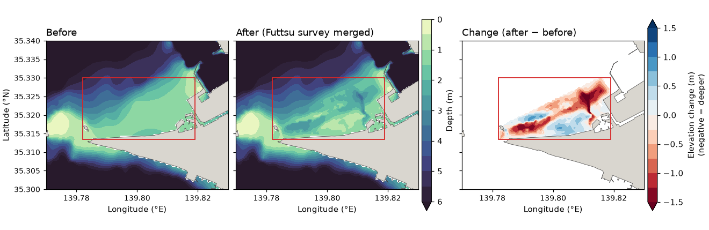

# Bathymetric DEM gridding — standard method (splines in tension)

Turning scattered/contour soundings into a regular **DEM** raster is a distinct step
from the vertical-datum conversion (see [`docs/vertical_datum.md`](vertical_datum.md)):
first convert depths to a common datum (T.P.), then grid.

topobathy grids with the **community-standard method: continuous-curvature splines
in tension** (Smith & Wessel 1990) via GMT `surface` — the algorithm behind GEBCO
and NOAA coastal DEMs. It is **smooth** (no TIN facets / gradient kinks) yet avoids
the overshoot of pure minimum-curvature, and it bridges digitised depth contours
**without the terracing** that TIN / nearest-neighbour produce on contour-derived
data such as M7001.

## Why this method (survey of standard practice)

| use | standard |
|---|---|
| International / research (GEBCO) | **splines in tension**, GMT `surface` (GEBCO Cook Book) |
| NOAA coastal topo-bathy DEMs (CUDEM) | splines in tension + hydro-flattening (MB-System/GMT/`waffles`) |
| Multibeam survey surface | **CUBE** (Calder & Mayer 2003; used by JCG ERS via CARIS) |
| Japanese official grids (JODC J-EGG500, JHA JTOPO30) | **TIN** from digitised soundings/contours |
| JMA (tsunami / storm surge) | uses existing grids (GEBCO / J-EGG / Cabinet-Office nested), no own method |

M7001 is **digitised depth contours** — the data type GEBCO/JTOPO rank lowest and
that suffers TIN terracing — so a tension spline (which crosses contours smoothly)
is the appropriate standard, over TIN.

## Pipeline (`topobathy.grid.grid_dem`, GMT via `pygmt`)

1. **`blockmedian`** — one median sounding per grid cell (robust decimation; removes
   redundancy/spikes, prevents aliasing).
2. **`surface`** — grid with a tension factor (~0.25–0.4 for bathymetry; `0.35`
   default). `coltypes="g"` → geographic metric, lon/lat grid.
3. **coverage mask** — blank cells farther than `mask_km` (default 2 km) from any
   sounding, so the grid is not extrapolated far into data gaps.
4. **hydro-flattening** — clip the DEM to water at the real **OSM coastline**
   (`land_geom`; via [`xcoast`](https://github.com/estuarine-utokyo/xcoast)), so land
   (incl. reclaimed land / artificial islands such as Haneda, 中央防波堤) is NaN and
   the water edge follows the true coast — not a distance buffer. OSM resolves
   reclaimed land that coarser coastlines (GSHHG) miss.

```python
from topobathy import grid_dem
from topobathy.grid import osm_land_geometry

region = (139.55, 140.30, 34.90, 35.75)
land = osm_land_geometry(region)                       # OSM land polygon (xcoast)
dem = grid_dem(lon, lat, z_tp, region=region, spacing=0.002, tension=0.35,
               mask_km=2.0, land_geom=land)             # xarray DataArray, T.P. (+up)
```

The OSM land mask needs the `xcoast` package plus the OSM shapefile extracts under
`$DATA_DIR/geodata/OSM/` (`land-polygons-split-4326`, geofabrik water); paths resolve via
`topobathy.config.osm_land_shp` / `osm_water_shp`. `topobathy-m7001-dem --no-land-mask`
falls back to the plain distance-coverage mask.

## Run

```bash
pjsub scripts/genkai_m7001_dem.sh          # Tokyo Bay DEM -> TP/M7001_dem_tokyobay.nc
# or directly:
topobathy-m7001-dem --region 139.55 140.30 34.90 35.75 --spacing 0.002 \
    --out $DATA_DIR/geodata/bathymetry/M7001/TP/M7001_dem_tokyobay.nc
```

Output: a CF NetCDF, variable `elevation` = seabed height above **T.P.** (m, +up;
seabed negative), NaN outside the coverage mask. Grids the `N` (depth-contour) and
`M` (low-tide-line) marks, which carry a T.P. elevation; `L` (HHW coastline) has no
depth and is excluded (it bounds the land side).

## The 50 m Tokyo Bay DEMs and what goes into them

Three 0.0005° (≈ 45 × 55 m) T.P. DEMs of Tokyo Bay sit in
`$DATA_DIR/geodata/bathymetry/M7001/TP/`, each the input of the next. **The default name
`M7001_dem_tokyobay_50m.nc` is the final one** (since 2026-10-24): M7001, with the Chiba
channel corrected from the Endo (2020) 50 m grid and the Fisheries Agency 2022 Futtsu
survey merged. The M7001-only grid that carried the default name until then is now
`M7001_dem_tokyobay_50m_m7001_only.nc`. A README beside the files
(`M7001_dem_tokyobay_50m.README.md`) says the same for users of the data archive.

```
M7001_TP.parquet ──topobathy-m7001-dem──▶ M7001_dem_tokyobay_50m_m7001_only.nc
  ──scripts/genkai_m7001_chiba_channel.sh (Endo 50 m)──▶ M7001_dem_tokyobay_50m_chiba_channel.nc
  ──scripts/genkai_futtsu_jfa_merge.sh (Futtsu 0.5 m)──▶ M7001_dem_tokyobay_50m.nc
```

| file | depth data used | other data used | built by |
|---|---|---|---|
| `M7001_dem_tokyobay_50m_m7001_only.nc` (139.50–140.35 E, 34.85–35.80 N; 2026-08-09; named `M7001_dem_tokyobay_50m.nc` until 2026-10-24) | **M7001 only** — the JHA digitised chart soundings (`N` contours, `M` low-tide line), converted chart datum → T.P. with the JCG/JMA tide-station datum model ([`vertical_datum.md`](vertical_datum.md)) | OSM land polygons via `xcoast` (hydro-flattening: land = NaN, step 4 above); no other bathymetry | `topobathy-m7001-dem --spacing 0.0005 --tension 0.35 --mask-km 2.0` over that window. The run was not kept as a job script; it is the same method and parameters as `scripts/genkai_m7001_dem_50m.sh` (Kanto-South window, `M7001_dem_kanto_south_50m.nc`), and where both have data the median difference is < 1e-5 m; single cells differ by up to 32 m, presumably where the splines of the two windows diverge (not examined) |
| `M7001_dem_tokyobay_50m_chiba_channel.nc` (same grid; 2026-10-23) | the grid above, **plus the Endo (2020) 50 m grid** for the Chiba channel only | — | `scripts/m7001_chiba_channel.py` (`scripts/genkai_m7001_chiba_channel.sh`); the method is also written into the file's global attributes (`chiba_channel_correction*`) |
| **`M7001_dem_tokyobay_50m.nc`** (same grid; 2026-10-24; **default**) | the grid above, **plus the Fisheries Agency 2022 Futtsu survey** (0.5 m) inside its footprint | — | `scripts/futtsu_jfa_merge.py` (`scripts/genkai_futtsu_jfa_merge.sh`); method in the global attributes (`futtsu_merge*`) |

### The Endo (2020) 50 m grid

`$DATA_DIR/geodata/bathymetry/tokyobay_endo/` holds a 50 m Tokyo Bay grid edited by
M. Endo in 2020 (see `東京湾地形データの編集手順.docx` there): an earlier 50 m point set of
the inner bay down to Kisarazu, with the separately surveyed dredged pits, shifted to the
GSI coastline, merged with the Sanbanze survey of FY2011 (Chiba Prefecture), and
IDW-interpolated to 50 m cells in JGD2011 zone IX. It resolves dredged channels that
M7001 does not. Two steps make it usable here:

1. `scripts/endo50m_to_lonlat.py` — the water cells (`Raster_data/50m_JGD_point_water`,
   `grid_code` = elevation, +up) → lon/lat NetCDF on the M7001 lattice
   (`tokyobay_endo/nc/endo_50m_lonlat.nc`), nearest cell.
2. `scripts/endo50m_to_tp.py` — the datum is not stated in the document; on **flat
   seabed** (3–25 m deep, slope < 0.002, |difference| < 3 m, so dredged pits, channels
   and harbours are left out) Endo is shallower than M7001 by a median **0.982 m**
   (IQR −1.14 to −0.86 m, n = 86 764), consistent with A.P. (T.P. − 1.134 m), the datum
   expected of an MLIT product. Taking M7001 as correct (owner), the grid is shifted by
   the measured 0.982 m rather than the nominal A.P. value
   (`tokyobay_endo/nc/endo_50m_lonlat_tp.nc`; the shift is in its attributes).
   Residual by sub-area: NW −0.20, NE −0.01, SW −0.04, SE +0.12 m.

The Endo grid is **not** used anywhere else in the DEM: its dredged pits are being
back-filled and its harbours and channels have been dredged since, so outside the Chiba
channel M7001 is kept.

### The Chiba channel correction

M7001 smears the dredged Chiba channel into a chain of bumps and leaves it 13–17 m deep
in places where the Endo grid shows a flat floor at about 19 m below T.P. The correction
(`scripts/m7001_chiba_channel.py`) does two things inside a corridor of 900 m either side
of the channel axis, with the corridor ends cut square to the axis so Chiba port itself
is untouched:

1. **flat seabed** — M7001 inside the corridor is discarded and refilled by harmonic
   (Laplace) interpolation from the M7001 values just outside it (land no-flux), which
   removes the channel soundings smeared into the flats and gives smooth contours;
2. **channel** — a straight dredged channel is cut along the axis with the cross-section
   measured from the Endo grid: flat floor at **18.98 m below T.P.** (Endo median within
   100 m of the axis; ≈ the 18 m design depth on Endo's own datum) to **175 m** from the
   axis, then a side slope of **0.04** (1:25, the slope the 50 m Endo grid shows) up to
   the refilled surface; depth = max(refilled, channel profile).

The axis is the centreline of the Endo channel floor (cells deeper than 18.7 m): a
straight leg `lat = 0.51672 lon − 36.78583` (139.975–140.06 E, rms 32 m), extended
south-west to 139.94 E where the natural depth reaches the floor, then the bend to the
port mouth at 140.085 E. Endo cells deeper than 20 m (borrow pits) are not used. Outside
the corridor the grid is M7001 unchanged. Result: corridor 27.2 km², of which channel
7.5 km²; flat-seabed change median −0.05 m; channel deepened by a median 0.94 m (max
9.2 m). Maps: [`figures/chiba_channel_m7001_original.png`](figures/chiba_channel_m7001_original.png),
[`figures/chiba_channel_m7001_corrected.png`](figures/chiba_channel_m7001_corrected.png).

### Data sets compared but NOT merged

These were only plotted against M7001 (inner-bay maps in `docs/figures/`), not merged:
Cabinet Office 2025 tsunami topography (10/30/90 m; median +0.18 m vs M7001 on 10–30 m
depths), the older Cabinet Office 30 m grid (`tokyo_bay/depth_0030-*`), JCG 500 m mesh
(median −1.68 m, chart datum) and SRTM15+ (−1.69 m).

### The Futtsu merge (Fisheries Agency 2022 survey)

`$DATA_DIR/geodata/bathymetry/Futtsu_JFA_2023/` (README there) is the Fisheries Agency's
2022 survey of the Futtsu flats: a 0.5 m grid in 43 tiles of 400 m × 300 m
(`05MCSV_TP/*.txt`, columns `id, easting, northing, elevation, flag`, JGD2011 zone IX =
EPSG:6677, elevation above T.P.; 13.4 M nodes; `MESH_TP/` is a byte-identical copy, the
raw point cloud `ORIGINAL_TP/` is not used). `scripts/futtsu_jfa_merge.py` merges it into
`M7001_dem_tokyobay_50m_chiba_channel.nc`:

1. **block median** — each node is transformed to lon/lat and assigned to the 0.0005° cell
   that contains it; the cell takes the median of its nodes, and is used only if the nodes
   cover ≥ 50 % of it (nodes × 0.25 m² / cell area), so half-empty edge cells do not carry
   a corner value. 1331 cells pass (of 1448 touched): 139.782–139.819 E,
   35.3135–35.330 N, elevation −4.0 to +1.4 m T.P.
2. **datum check** — both are T.P., so **no shift** is applied. On flat seabed (1–20 m,
   slope < 0.002 in both) the survey is lower than the base by a median 0.61 m (IQR −1.02
   to −0.03 m), but only 93 cells qualify, and over all 1299 overlapping water cells the
   median is −0.49 m: the difference is mainly the tidal channels of the flats, which the
   survey resolves and the M7001 spline fills in (see the difference map), not a datum
   offset. The 2022 0.5 m survey is taken as the better description of the flats.
3. **merge** — inside the footprint the DEM takes the survey value, with a linear ramp over
   the first **250 m** inside the footprint edge (base at the edge, survey at full
   weight), so no step is left; only water cells of the base are changed, so its OSM land
   mask is kept. 1299 cells (3.28 km²) changed, 599 at full weight; change median
   −0.28 m (5–95 % −1.36 to +0.56 m).

The job writes a staging file first (`M7001_dem_tokyobay_50m_futtsu_staging.nc`); after the
checks above it was renamed to the default name and the M7001-only grid to
`M7001_dem_tokyobay_50m_m7001_only.nc`. To rebuild: `pjsub scripts/genkai_futtsu_jfa_merge.sh`,
check, then rename the same way.

Before | after | change, red box = survey footprint
([`scripts/genkai_plot_futtsu_compare.sh`](../scripts/genkai_plot_futtsu_compare.sh)):



Single maps at full size: [`figures/futtsu_merge_before.png`](figures/futtsu_merge_before.png),
[`figures/futtsu_merge_after.png`](figures/futtsu_merge_after.png),
[`figures/futtsu_merge_diff.png`](figures/futtsu_merge_diff.png).

**Figures drawn from the default DEM** (redrawn 2026-10-24 at 150 dpi, ≈ 1000 px wide):
`figures/tokyobay_depth_tp_chiba_channel.png`, `..._boso_box.png` and `..._mounds.png`
(the file names keep `chiba_channel` from before the Futtsu merge; the content is the
default DEM). The inner-bay and Boso close-up maps do not reach Futtsu and were not redrawn.

A 10 m / 5 m DEM on the same window from the original data: feasibility and plan in
[`dem_hires_plan.md`](dem_hires_plan.md).

## Notes & refinements

- **Tension** trades smoothness vs. faithfulness; raise it (→0.4–0.5) if the spline
  overshoots into small positive elevations in shallow corners.
- **Hydro-flattening** clips the DEM to water at the **OSM coastline** (step 4); OSM
  captures reclaimed land / artificial islands that GSHHG or the M7001 `L` waterline
  may not. `--no-land-mask` reverts to the distance-coverage mask only.
- **Compositing** multiple sources (M7001 + CUDEM/GEBCO/SRTM15plus/… under
  `$DATA_DIR/geodata/bathymetry`) follows the same GEBCO/NOAA workflow: assemble by data
  priority → tension-spline grid → mask/flatten. This is the natural next tool.

## References

- Smith, W. H. F. & Wessel, P. (1990) *Gridding with continuous curvature splines
  in tension*, Geophysics 55(3). [doi:10.1190/1.1442837](https://doi.org/10.1190/1.1442837)
- IHO-IOC **GEBCO Cook Book**. <https://www.gebco.net/data-products/gebco-cook-book>
- NOAA **CUDEM** (Amante et al. 2023). <https://www.mdpi.com/2072-4292/15/6/1702>
- Calder, B. R. & Mayer, L. A. (2003) *Automatic processing of high-rate,
  high-density multibeam data* (**CUBE**), G-cubed 4(6).
- JODC **J-EGG500** / JHA **JTOPO30** (TIN-based Japanese grids).
  <https://www.jodc.go.jp/jodcweb/JDOSS/infoJEGG_j.html>
