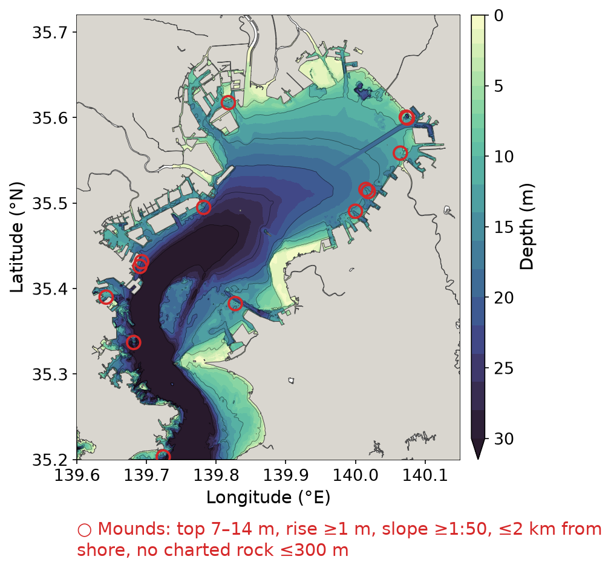
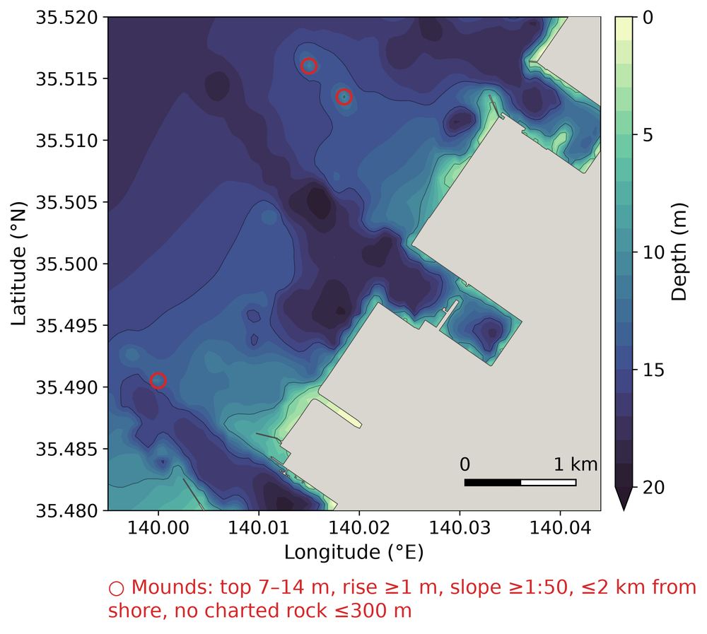

# Seabed mound detection

Finds small seabed mounds — local rises that stand out from the surrounding seabed — on a
lon/lat depth grid, and marks their tops on a depth map. It was written to locate mounds
whose tops are likely **sandy within a muddy seabed** in Tokyo Bay, so it can also reject
broad, gentle swells, artificial structures and charted rocky ground. Every threshold is
an argument; nothing is specific to Tokyo Bay.

| piece | file |
|---|---|
| detection (library) | [`topobathy/grid/mounds.py`](../topobathy/grid/mounds.py) — `find_mounds()` |
| map + marking (CLI) | [`scripts/plot_depth_map.py`](../scripts/plot_depth_map.py) — `--mounds` and the `--mound-*` options |
| GENKAI jobs | [`scripts/genkai_plot_tokyobay_mounds.sh`](../scripts/genkai_plot_tokyobay_mounds.sh) (whole bay), [`scripts/genkai_plot_boso_zoom.sh`](../scripts/genkai_plot_boso_zoom.sh) (Boso close-up), [`scripts/genkai_list_boso_mounds.sh`](../scripts/genkai_list_boso_mounds.sh) (candidates without the slope filter) |
| results | [`figures/tokyobay_mounds.csv`](figures/tokyobay_mounds.csv), [`figures/boso_ichihara_mounds.csv`](figures/boso_ichihara_mounds.csv) |



*Figure 1. Seabed mounds (red circles) on the T.P. depth map of Tokyo Bay, 139.60–140.15 E,
35.20–35.72 N: summit 7–14 m deep, ≥ 1 m above the surrounding seabed, ≤ 2 km from
shore, mean upper-flank slope ≥ 1:50, no charted rock within 300 m; Umi-hotaru excluded.
14 mounds. Depth: the 50 m Tokyo Bay DEM `M7001_dem_tokyobay_50m.nc` (M7001 converted to
T.P., Chiba channel corrected, Futtsu 2022 survey merged; see [`dem.md`](dem.md)). Full resolution: [`figures/tokyobay_depth_tp_chiba_channel_mounds.png`](figures/tokyobay_depth_tp_chiba_channel_mounds.png).*

## Method

### 1. Height above the surrounding seabed = topographic prominence

A mound is a local summit of the seabed (a local minimum of depth). Its height above the
surrounding seabed is its **prominence**: the summit elevation minus the highest saddle
(col) through which it connects to higher terrain — another, higher summit or the shore.
Prominence needs no window size and no smoothing, and it measures each mound against its
own col, so a mound on a slope that rises to the shore is measured against the col
towards the shore, not against an arbitrary reference depth.

It is computed exactly in one sweep: the cells are visited from shallow to deep and
joined into components with a union-find (8-connected). When two components meet at a
cell, the one with the lower summit ends there, and its prominence is its summit minus
that cell's elevation. Land and no-data cells are given the highest elevation, so the
shore is the highest terrain of all.

### 2. Size and steepness from the upper half

The cells above the col are not a usable footprint: on a flat surrounding seabed the col
is the flat itself and the "base" spreads over the whole flat. Size and steepness are
therefore measured on the **upper half** of the mound — the cells connected to the summit
that lie above `summit − prominence / 2`:

* `width` — equivalent-circle diameter of that area (full width at half height), m;
* `slope` — mean flank slope of the upper half, `(prominence / 2) / (width / 2)`, m/m.

On synthetic Gaussian mounds this gives the expected full width at half height (≈ 260 m
for σ ≈ 95 m, theory 224 m; ≈ 1190 m for σ ≈ 475 m, theory 1120 m — the excess is the
50 m cell size).

### 3. Filters

A summit is kept when all of these hold:

| criterion | argument (`plot_depth_map.py`) | `find_mounds()` | Tokyo Bay value |
|---|---|---|---|
| summit depth in a range | `--mound-depth ZMIN ZMAX` | `zmin`, `zmax` | 7 14 m |
| prominence at least | `--mound-prominence` | `min_prominence` | 1 m |
| summit within a distance of land | `--mound-shore-dist` | `max_shore_dist` | 2000 m |
| mean upper-flank slope at least | `--mound-min-slope` | `min_slope` | 0.02 (1:50) |
| width at half height in a range | `--mound-width MIN MAX` | `width_range` | not used |
| not inside a box (repeatable) | `--mound-exclude-box W E S N` | — | Umi-hotaru |
| no classified point of given classes near the top | `--mound-exclude-points CSV`, `--mound-exclude-classes`, `--mound-exclude-radius` | — | charted rock, 300 m |

Distance to land is the Euclidean distance (in metres) to the nearest land / no-data cell
of the DEM. The search runs on the raw DEM read with a margin of `--mound-shore-dist` +
1 km around the map frame, so neither prominence nor shore distance is cut at the frame;
only summits inside the frame are drawn. Display-only options of the map (such as
`--fill-gaps`) do not affect the detection.

**Choice of the slope threshold.** Without a slope filter the five Boso candidates had
slopes 1:23, 1:35, 1:45, 1:93 and 1:120; 1:50 falls in the clear gap and drops the two
gentle swells.

**Rocky ground.** The charted bottom-sediment points (海しる, Japan Coast Guard) archived by
the `sediment` repository, `$DATA_DIR/sediment/substrate/msil_chart_substrate_points.csv`
(columns `lon, lat, class`; see its README), are used to drop mounds on charted rock. 300 m
is about twice the median chart-point spacing (151 m). On the Miura (Yokosuka) shore this
removed 12 of the 27 candidates; 8 of them had a rock point within 100 m of the top.

**Umi-hotaru** (Tokyo Bay Aqua-Line artificial island, 139.871 E 35.464 N) is removed by
the box 139.862–139.880 E, 35.460–35.472 N: an artificial structure, not a seabed mound.

## Usage

Map with marked mounds (GENKAI: run through the job scripts above, `pjsub`):

```bash
python scripts/plot_depth_map.py \
    --dem $DATA_DIR/geodata/bathymetry/M7001/TP/M7001_dem_tokyobay_50m.nc \
    --region 139.60 140.15 35.20 35.72 --vmax 30 \
    --mounds --mound-depth 7 14 --mound-prominence 1 --mound-shore-dist 2000 \
    --mound-min-slope 0.02 \
    --mound-exclude-box 139.862 139.880 35.460 35.472 \
    --mound-exclude-points $DATA_DIR/sediment/substrate/msil_chart_substrate_points.csv \
    --mound-exclude-classes rock --mound-exclude-radius 300 \
    --mound-csv docs/figures/tokyobay_mounds.csv \
    --no-title --no-note --font-size 14 --cbar-label "Depth (m)" \
    --out docs/figures/tokyobay_depth_tp_chiba_channel_mounds.png
```

The job log lists every mound kept and every mound excluded (and why). The criteria are
written in one short line under the map by default; `--no-mound-label` omits it.

From Python (depth positive down, NaN or ≤ 0 = land / no data):

```python
from topobathy.grid.mounds import find_mounds
mounds = find_mounds(depth, lon, lat, zmin=7, zmax=14, min_prominence=1,
                     max_shore_dist=2000, min_slope=0.02)
# [{'lon', 'lat', 'depth', 'prominence', 'width', 'slope', 'shore_dist'}, ...]
```

## Output

`--mound-csv` columns: `lon`, `lat` (summit, °), `depth` (m below the DEM datum, here
T.P.), `prominence` (m), `width` (m, at half height), `slope` (m/m), `shore_dist` (m).
Highest prominence first.



*Figure 2. Close-up of the Boso shore (Ichihara–Sodegaura), 139.995–140.044 E,
35.48–35.52 N, 1 m colour steps to 20 m, with the three mounds of Figure 1 in this frame
(the rectangle on [`figures/tokyobay_depth_tp_chiba_channel_boso_box.png`](figures/tokyobay_depth_tp_chiba_channel_boso_box.png)).
Full resolution: [`figures/boso_ichihara_zoom_depth.png`](figures/boso_ichihara_zoom_depth.png).*

## Results (Tokyo Bay, criteria of Figure 1)

| lon (E) | lat (N) | depth (m) | prominence (m) | width (m) | slope | shore (m) | remark |
|---|---|---|---|---|---|---|---|
| 139.6815 | 35.3370 | 7.29 | 8.45 | 227 | 1:27 | 1983 | Miura shore; rock point 445 m away |
| 139.6930 | 35.4315 | 11.94 | 6.09 | 127 | 1:21 | 483 | off the Yokohama waterfront (Honmoku), port area |
| 139.6905 | 35.4260 | 13.49 | 5.18 | 57 | 1:11 | 467 | off the Yokohama waterfront (Honmoku), port area |
| 140.0185 | 35.5135 | 9.60 | 4.84 | 113 | 1:23 | 1266 | Boso, Figure 2 |
| 139.7240 | 35.2030 | 13.52 | 4.36 | 98 | 1:23 | 951 | Miura shore; rock point 373 m away |
| 139.8175 | 35.6175 | 7.44 | 3.70 | 98 | 1:27 | 760 | inside Tokyo port |
| 140.0745 | 35.5995 | 10.67 | 3.23 | 57 | 1:18 | 493 | Chiba port mouth |
| 140.0150 | 35.5160 | 11.27 | 3.21 | 113 | 1:35 | 1656 | Boso, Figure 2 |
| 139.7820 | 35.4950 | 11.53 | 2.44 | 113 | 1:47 | 593 | off Kawasaki |
| 139.8275 | 35.3825 | 9.52 | 2.31 | 113 | 1:49 | 1832 | off Kimitsu |
| 139.6420 | 35.3900 | 11.36 | 2.04 | 80 | 1:39 | 215 | Yokohama (Isogo) shore |
| 140.0645 | 35.5585 | 9.16 | 2.02 | 80 | 1:40 | 841 | off Chiba |
| 140.0000 | 35.4905 | 11.50 | 1.77 | 80 | 1:45 | 919 | Boso, Figure 2 |
| 140.0730 | 35.6005 | 10.34 | 1.57 | 57 | 1:36 | 522 | Chiba port mouth |

## Limitations

* **Resolution.** The half-height widths, 57–227 m, are 1–5 cells of the 50 m DEM: the
  mounds are barely resolved, so `width` is coarse and `slope` is probably underestimated.
  Use the values to rank and filter, not as measured shapes. M7001 is gridded from
  soundings by splines in tension; a single shoal sounding can make a 1–2 m, two-cell
  mound, so the small ones are the least certain.
* **Substrate is not observed here.** Dropping charted rock does not make the rest sandy.
  The chart points lack pure-mud records (the 泥・粘土 service is not available), and the
  bay-interior grain-size field of `$DATA_DIR/sediment/nc/tokyobay_wc_grid.nc` is
  interpolated from sparse samples and does not resolve features of this size.
* **Ports and structures.** Mounds inside ports or at port mouths, and those near the
  Yokohama (Honmoku) waterfront, may be dredging remnants or structures; Umi-hotaru is the
  only one removed so far.
* **Datum.** `depth` is relative to the DEM's datum (T.P. for the M7001 T.P. DEM).
